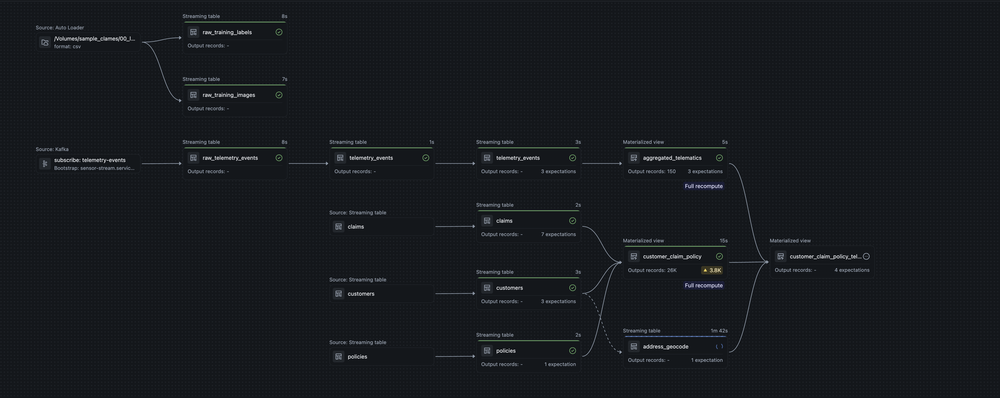
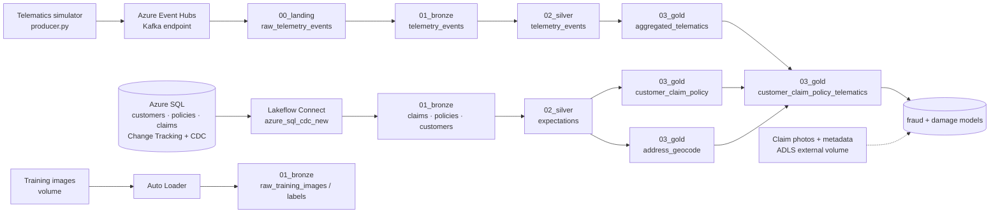

# sample_clames_pipeline

End-to-end **motor-insurance smart-claims lakehouse** on Azure and Databricks. A simulated telematics stream and a transactional Azure SQL database
(realistic, deliberately dirty synthetic data) are ingested into **Databricks Lakeflow**, cleaned with data-quality expectations and joined into
claim-level gold tables, ready for fraud rules, a statistical fraud model and a computer-vision damage model.

> **ETL pipeline name: `sample_clames_pipeline`** (Lakeflow Spark Declarative Pipeline, Unity Catalog `sample_clames`).
> A second pipeline, `azure_sql_cdc_new` (Lakeflow Connect), copies the SQL tables into its bronze layer.



## Contents

1. [Architecture](#architecture)
2. [Repository structure](#repository-structure)
3. [Getting started](#getting-started)
4. [Data](#data)
5. [Pipeline design](#pipeline-design)
6. [Documentation](#documentation) · [Status](#status) · [Security](#security) · [License](#license)

## Architecture



| Layer | Schema in `sample_clames` | Contents |
|---|---|---|
| Landing | `00_landing` | Raw Kafka envelope; volumes for claim photos, training images, gateway staging |
| Bronze | `01_bronze` | Parsed telemetry, CDC copies of the SQL tables, raw training images and labels |
| Silver | `02_silver` | Cleaned tables with `expect_*` data-quality rules |
| Gold | `03_gold` | Per-vehicle telematics, claim + policy + customer, geocode cache, final claim-level table |

Join keys: `chassis_no` (telematics ↔ policies ↔ image metadata), `policy_no` (claims ↔ policies), `claim_no` (claims ↔ ground truth ↔ image metadata).

**Stack:** Azure Event Hubs · Azure SQL Database (serverless) · ADLS Gen2 · Azure Databricks (Unity Catalog, serverless Spark Declarative Pipelines,
Lakeflow Connect, Auto Loader) · SQL Server Change Tracking / CDC · Python with `uv`.

## Repository structure

```
sample_clames_pipeline/
├── databricks.yml                      Databricks Asset Bundle (targets, variables)
├── resources/                          bundle resources (pipeline definition)
├── src/                                all source code
│   ├── sample_clames_pipeline/         Databricks ETL pipeline
│   │   └── transformations/
│   │       ├── 00_landing/             Kafka → raw table
│   │       ├── 01_bronze/              JSON parsing, Auto Loader for images
│   │       ├── 02_silver/              cleaning + data-quality expectations
│   │       └── 03_gold/                joins, aggregates, geocoding
│   └── smart_clames/                   Python tooling
│       ├── streaming/                  telematics simulator → Event Hubs
│       ├── database/                   Azure SQL loaders
│       └── synthetic_data/             data, photo and training-set generators
├── tests/                              unit tests (pytest)
├── infra/                              infrastructure as scripts
│   ├── azure/setup.sh                  resource group, storage, Event Hubs, SQL, access connector
│   └── databricks/
│       ├── unity_catalog.sql           catalog, schemas, external location, volumes
│       └── pipelines/*.json            sanitized specs of the existing workspace pipelines
├── sql/                                source database scripts (run in order 01 → 03)
├── data/                               small committed datasets + answer keys
├── docs/                               setup guides, architecture decision records (adr/), project log
├── .github/                            CI workflow, CODEOWNERS, PR template
├── Makefile · pyproject.toml · uv.lock tooling and locked environment
├── .pre-commit-config.yaml · .editorconfig
├── CONTRIBUTING.md · SECURITY.md · CHANGELOG.md · LICENSE
└── .env.example                        required environment variables (copy to .env)
```

Every top-level folder has its own `README.md` with the details.

## Getting started

**Prerequisites:** Azure subscription, Azure CLI, a Databricks workspace with Unity Catalog, Databricks CLI ≥ 1.0, [`uv`](https://docs.astral.sh/uv/).

```bash
git clone https://github.com/junaidiqbalsyed/sample_clames_pipeline.git
cd sample_clames_pipeline
uv sync
cp .env.example .env            # fill in Event Hubs + Azure SQL values; .env is git-ignored
```

| Step | Command / file | Details |
|---|---|---|
| 1. Azure resources | `SQL_PASSWORD='<choose>' bash infra/azure/setup.sh` | [docs/azure-setup.md](docs/azure-setup.md) |
| 2. Source database | `uv run python src/smart_clames/database/load_sql_server.py` (drops existing tables) | [sql/README.md](sql/README.md) |
| 3. Synthetic data | `uv run python src/smart_clames/synthetic_data/generate_synthetic.py`, then `.../database/load_synthetic.py` | [data/README.md](data/README.md) |
| 4. Change tracking | run `sql/02_enable_change_tracking.sql`, `sql/03_lakeflow_utility_objects.sql` | [sql/README.md](sql/README.md) |
| 5. Databricks | `infra/databricks/unity_catalog.sql`, Lakeflow Connect, deploy with the bundle (`databricks.yml`) | [docs/databricks-setup.md](docs/databricks-setup.md) |
| 6. Stream telematics | `uv run python src/smart_clames/streaming/producer.py --vehicles 50 --speedup 30` | `--dry-run` prints events and rewrites `data/replay_plan.csv`; `--live` stamps events with now |

## Data

| Dataset | Location | Notes |
|---|---|---|
| Telematics sample | `data/telematics/` | 780k rows, 11.6k vehicles, NYC; calibrates the simulator |
| Original SQL data | `data/sql_server/` | 7,061 customers / 12,236 policies / 12,991 claims (mostly random noise, kept as-is) |
| Synthetic SQL data | `data/sql_server_synthetic/` | 23,000 customers / 68,512 policies / 13,316 claims with valid VINs and NYC geography |
| Answer keys | `claims_ground_truth.csv`, `dirty_manifest.csv`, `dirty_issues.csv`, `replay_plan.csv` | Fraud label and scenario per claim; every injected garbage value |
| Claim photos, training images | Databricks volumes (not in git) | 24,448 EXIF-tagged claim photos; 10,913 labelled training images (`ok` / `minor` / `major`) |

Azure SQL ends with **30,061 customers · 80,748 policies · 26,307 claims**.
Fraud is 40 % of synthetic claims (`--fraud-rate`), across ten scenarios: genuine, genuine repeat, genuine hard negative, genuine two-insured,
inflated, staged accident, serial claimant, soon-after-inception, theft fraud, duplicate submission. 37 kinds of garbage values give the silver expectations something to catch.

## Pipeline design

| Layer | Table | Type | Behaviour |
|---|---|---|---|
| landing | `raw_telemetry_events` | streaming | Kafka reader on Event Hubs authenticated by a Unity Catalog service credential |
| bronze | `telemetry_events` | streaming | `from_json` on the 5-field payload |
| bronze | `raw_training_images`, `raw_training_labels` | streaming (Auto Loader) | binary images and `labels.csv` from a volume |
| bronze | `claims`, `policies`, `customers` | streaming | filled by Lakeflow Connect |
| silver | `claims`, `customers`, `policies`, `telemetry_events` | streaming | `expect_or_drop` rules: 188 claims and 2,829 customers dropped on the last run |
| gold | `aggregated_telematics` | materialized view | per-vehicle speed and position |
| gold | `customer_claim_policy` | materialized view | claim left-joined to policy and customer, orphans measured not dropped |
| gold | `address_geocode` | streaming | each distinct address geocoded once |
| gold | `customer_claim_policy_telematics` | materialized view | final claim-level table with location and telematics |

Design choices: no secrets in code (managed identity), reference joins in batch to avoid unbounded stream state, warn-only expectations in gold to measure rather than lose claims.
Layer-by-layer detail and row counts: [docs/databricks-setup.md](docs/databricks-setup.md).

## Engineering practices

- **Deployment as code:** `databricks.yml` + `resources/` (validated with `databricks bundle validate`); infrastructure scripts in `infra/`.
- **Quality gates:** `make check` runs ruff and pytest; CI (GitHub Actions) also runs a gitleaks secret scan on every push and pull request.
- **Governance:** CODEOWNERS, PR template, [CONTRIBUTING](CONTRIBUTING.md), [SECURITY](SECURITY.md), [CHANGELOG](CHANGELOG.md), decision records in [docs/adr](docs/adr/README.md).
- **Security by default:** managed identity instead of keys, `.env` git-ignored, sanitized specs.

## Documentation

| Document | Content |
|---|---|
| [docs/azure-setup.md](docs/azure-setup.md) | Azure resources, networking, gotchas |
| [docs/databricks-setup.md](docs/databricks-setup.md) | Unity Catalog, Lakeflow Connect, pipeline settings, deployment, row counts |
| [docs/adr/](docs/adr/README.md) | Architecture decision records |
| [docs/project-log.md](docs/project-log.md) | Chronological build log and design decisions |

## Status

- [x] Azure infrastructure, SQL source with Change Tracking and CDC, Lakeflow Connect
- [x] Event Hubs → landing → bronze → silver → gold with expectations and geocoding
- [x] Training images ingested with Auto Loader
- [ ] Schedule with a Lakeflow Job and package as a Declarative Automation Bundle
- [ ] Fraud rule engine and statistical model on `customer_claim_policy_telematics`
- [ ] Damage classifier (balance classes, evaluate on `test_street`, never train on claim photos)

## Security

No credentials are committed. `.env` is git-ignored, Databricks reads Event Hubs through a managed identity, and pipeline specs are sanitized.
Third-party photos (Wikimedia Commons, Hugging Face, a private-study accident set) are excluded from the repository.

## License

Apache 2.0, see [LICENSE](LICENSE).
