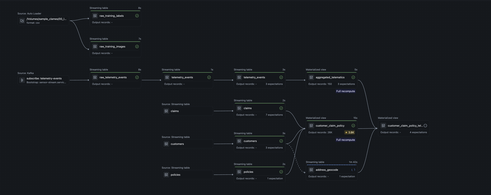

# Databricks setup

Everything in the Databricks workspace, in the order it was built. Names are literal; schema names start with a digit, so
backtick-quote them in SQL (`` sample_clames.`01_bronze`.claims ``).

## 1. Unity Catalog foundations

| Object | Name | Notes |
|---|---|---|
| Storage credential | `claims-external-container` | Azure access connector `ac-databricks-certification` (managed identity, role *Storage Blob Data Contributor* on the storage account) |
| External location | `claims_external_location` | `abfss://claims@certificationprep001.dfs.core.windows.net/` |
| Service credential | `eventhub_sensor_stream_cred` | Same access connector, role *Azure Event Hubs Data Receiver* on the Event Hubs namespace. Used by the Kafka reader, so **no connection string or key is stored anywhere** |
| Catalog / schemas | `sample_clames` / `00_landing`, `01_bronze`, `02_silver`, `03_gold` | See [`infra/databricks/unity_catalog.sql`](../infra/databricks/unity_catalog.sql) |
| Volumes | `customer_claims` (external), `training_images` (managed) | Claim photos + metadata, damage-classifier training set |

Credentials and connections are created in **Catalog Explorer → External Data**; the rest is plain SQL.

## 2. Lakeflow Connect: Azure SQL → bronze (CDC)

Source prerequisites (already scripted in [`sql/`](../sql)): Change Tracking + CDC on `dbo.customers/policies/claims`,
Databricks utility objects v1.7, DDL audit table + trigger, `lakeflowFixPermissions` for the SQL user.

1. **Connection** `azure_sql_cdc` (type SQL Server, `jd-sql-learn-2026.database.windows.net:1433`, user/password; trust-server-certificate on).
2. **Ingestion gateway + pipeline** `azure_sql_cdc_new` (spec: [`infra/databricks/pipelines/azure_sql_cdc_new.json`](../infra/databricks/pipelines/azure_sql_cdc_new.json)).
   The gateway stages change events in the volume `__databricks_ingestion_gateway_staging_data-<id>` (auto-created, do not delete); the serverless ingestion
   pipeline applies them to `sample_clames.01_bronze.{claims,policies,customers}`.
3. Run it triggered (Lakeflow Connect has no continuous mode); schedule with a Job `pipeline_task` if wanted.

## 3. Declarative pipeline `sample_clames_pipeline`

Spec: [`infra/databricks/pipelines/sample_clames_pipeline.json`](../infra/databricks/pipelines/sample_clames_pipeline.json), source:
[`pipelines/sample_clames_pipeline/transformations/`](../pipelines/sample_clames_pipeline/transformations). Serverless, Photon, triggered, default catalog
`sample_clames`, default schema `01_bronze`. Pipeline configuration:

| Key | Value | Used by |
|---|---|---|
| `event_hub_namespace` | `sensor-stream` | `00_landing/raw_telemetry.py` |
| `event_hub_name` | `telemetry-events` | same |
| `service_credential_name` | `eventhub_sensor_stream_cred` | same |
| `smart_claims.geocode_mode` *(optional)* | `nominatim` (default) or `demo` | `03_gold/customer_claim_policy_telematics.py` |
| `smart_claims.geocoder_user_agent` *(optional)* | identifying UA string for Nominatim | same |

Environment dependency: `geopy`.

### Deploying the code

```bash
P=<your-cli-profile>
# workspace → local (how the repo copy was produced)
databricks workspace export-dir "/Workspace/Users/<you>/clames/sample_clames_pipeline" pipelines/sample_clames_pipeline --profile $P
# local → workspace
databricks workspace import-dir pipelines/sample_clames_pipeline "/Workspace/Users/<you>/clames/sample_clames_pipeline" --overwrite --profile $P
# create the pipeline from the sanitized spec (replace <your-user-id> in the JSON first)
databricks pipelines create --json @infra/databricks/pipelines/sample_clames_pipeline.json --profile $P
databricks pipelines start-update <pipeline-id> --profile $P
```

### Layer by layer

| Layer | Table | Type | What it does |
|---|---|---|---|
| landing | `00_landing.raw_telemetry_events` | streaming | Kafka reader on the Event Hubs endpoint (`:9093`) with the service credential; raw envelope + `landing_timestamp`; `pipelines.reset.allowed=false` protects the archive |
| bronze | `01_bronze.telemetry_events` | streaming | `from_json` on the 5-column payload (`chassis_no, latitude, longitude, event_timestamp, speed`), change data feed on |
| bronze | `01_bronze.raw_training_images` / `raw_training_labels` | streaming (Auto Loader) | `binaryFile` over `/Volumes/…/training_images` (+ split / folder_label / file_name from the path) and `labels.csv` with schema evolution + rescued data |
| bronze | `01_bronze.claims/policies/customers` | streaming | Written by the Lakeflow Connect ingestion pipeline (section 2) |
| silver | `02_silver.telemetry_events` | streaming | Parses the timestamp; drops invalid lat/long/timestamp |
| silver | `02_silver.claims` | streaming, clustered by year/month | Parses `MM-dd-yyyy` dates; `expect_all_or_drop`: claim id, claim/incident date not in the future, total > 0, hour 0–23, driver age 16–85, licence date |
| silver | `02_silver.customers` | streaming | "Last, First" → first/last name; drops null key, null DOB, age ≤ 16 |
| silver | `02_silver.policies` | streaming | `abs(premium)` fixes sign errors; drops null `policy_no` |
| gold | `03_gold.aggregated_telematics` | materialized view | Per-vehicle avg/max speed, avg position, event count; warn-only expectations |
| gold | `03_gold.customer_claim_policy` | materialized view | Claim LEFT JOIN policy LEFT JOIN customer (orphans kept and measured, not dropped) |
| gold | `03_gold.address_geocode` | streaming | Geocodes each distinct "BOROUGH, ZIP" once (exactly-once cache via `dropDuplicates`); Nominatim at ≤ 1 req/s or an offline deterministic `demo` mode |
| gold | `03_gold.customer_claim_policy_telematics` | materialized view | Final claim-level table + `lat_long` + telematics aggregates; input for fraud rules / ML |



### Last verified row counts

| Table | Rows | | Table | Rows |
|---|---:|---|---|---:|
| `01_bronze.claims` | 26,307 | | `02_silver.claims` | 26,119 (188 dropped by expectations) |
| `01_bronze.customers` | 30,061 | | `02_silver.customers` | 27,232 (2,829 dropped) |
| `01_bronze.policies` | 80,748 | | `02_silver.policies` | 80,748 |
| `01_bronze.telemetry_events` | 24,517 | | `02_silver.telemetry_events` | 24,517 |
| `01_bronze.raw_training_images` | 10,913 | | `03_gold.customer_claim_policy` | 26,119 |
| `03_gold.aggregated_telematics` | 150 | | `03_gold.customer_claim_policy_telematics` | 26,119 |
| `03_gold.address_geocode` | 368 | | | |

The dropped rows are the deliberate garbage from `generate_synthetic.py`; `data/sql_server_synthetic/dirty_manifest.csv` is the answer key.

## 4. Moving data into volumes (CLI)

```bash
databricks fs cp <local dir> dbfs:/Volumes/sample_clames/00_landing/<volume>/<dir> --recursive --overwrite --profile $P
databricks fs ls dbfs:/Volumes/sample_clames/00_landing/<volume> --profile $P
```

Large uploads run ≈250 files/min. Verify counts per folder before deleting local copies, and remove stray `.DS_Store` files.
Claim photos and `image_metadata.csv` belong in the **external** volume `customer_claims` (ADLS container `claims`); the training set lives only in the managed volume `training_images`.
